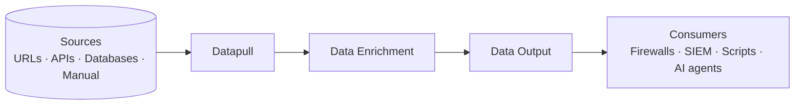

<div align="center">

# BYO-INT

**Your intel, your way.**

An extensible, self-hosted platform for managing your own threat intelligence and integrations.

[](LICENSE)


[Overview](#overview) •
[Components](#core-components) •
[Quick Start](#quick-start) •
[Datapull Templates](#datapull-templates) •
[Configuration](#configuration) •
[Contributing](#contributing)

</div>

---

## Overview

**BYO-INT** ("bring your own intel") is for people who want to manage their own threat intel and integrations instead of relying on a closed platform.

It pairs a **Flask** backend and a **MongoDB** datastore with a **Redis**-backed worker queue. A **Vue 3** frontend is served over HTTPS through Nginx.



## Core Components

| Component | What it does |
|---|---|
| **Datapull** | Fetches indicator data from different sources. **Static** datapulls are for manual entries or one-time loads from a static source. **Dynamic** datapulls are for external or changing sources, and can run on a schedule. |
| **Data Enrichment** | Enriches the data extracted from sources. Other components can use the enrichment results as filters. |
| **Data Output** | Generates output that external integrations and tools can consume: plain-text **EDL feeds**, authenticated **JSON** feeds, or an authenticated **MCP server** for AI agents. |

## Directory Layout

```text
.
├── byoint_core/          # Flask API, auth/RBAC, datapull workflows, bootstrap/init logic
├── byoint-web/           # Vue 3 frontend and Nginx container config
├── certs/                # Optional TLS certificates mounted into the web container
├── docs/                 # Project documentation and API references
├── scripts/              # Utility scripts (e.g. security scan)
├── docker-compose.yml    # Canonical local orchestration file
└── mongo_init.json       # Seed data for the Mongo bootstrap workflow
```

## Deployment

| Platform | Status |
|---|---|
| Docker Desktop (Windows) | ✅ Supported |
| Docker (any Linux) | ✅ Supported |
| AWS | ⚠️ Not tested |
| Azure | ⚠️ Not tested |
| Podman | ⚠️ Not tested |
| Kubernetes | ⚠️ Not tested |

## Quick Start

### Prerequisites

- Docker with Compose v2 (Docker Desktop on Windows)
- Git

### 1. Clone and configure

```bash
git clone https://github.com/aniabraham83/byo-int.git
cd byo-int
cp .env.example .env
```

Edit `.env` and set at least:

```ini
MONGO_INITDB_ROOT_USERNAME=<mongo user>
MONGO_INITDB_ROOT_PASSWORD=<mongo password>
FLASK_SECRET_KEY=<long random secret>
DATAPULL_SECRET_MASTER_KEY=<long random secret>
BYOINT_ADMIN_PASSWORD=<strong password>
SNIPPET_RUNNER_TOKEN=<long random secret>
MONGO_INIT_WORKFLOW=init          # seed data on first start
```

### 2. Start the stack

```bash
docker compose up -d --build
```

### 3. Open the app

| What | URL |
|---|---|
| Web UI | `https://localhost/` or `https://<host-ip>/` |
| API docs (Swagger) | `https://localhost/api/docs` or `https://<host-ip>/api/docs` |

Port 443 is published on all of the host's interfaces, so other machines on your network can reach the UI, feeds and MCP endpoints at the host's IP address or DNS name. Use that address when you configure firewalls, SIEMs or AI agents to consume outputs. To allow access only from this machine, change the `vue_app` port mapping in `docker-compose.yml` to `"127.0.0.1:443:8443"`.

> [!NOTE]
> By default the web container uses a self-signed certificate issued for `localhost`, so browsers and clients will show a warning on first visit, and also when they connect by IP or hostname. See [HTTPS and TLS certificates](#https-and-tls-certificates) to use your own certificate that covers the address clients use.

## Datapull Templates

Datapull workflows are created from **Datapull templates**. Built-in templates cover common needs, and you can add custom templates for more advanced ones.

| Built-in template | Description |
|---|---|
| `generic_url_text` | Extracts indicators from a web URL. Designed for feed-style URLs with one indicator per line. |
| `api_bearer` | Pulls indicators from an API that uses Bearer token authentication. |
| `api_with_key` | Pulls indicators from an API that uses an API key. |
| `api_basicauth` | Pulls indicators from an API that uses HTTP Basic authentication. |
| `basic_mysql_query` | Runs a query against MySQL. |
| `basic_mssql_query` | Runs a query against Microsoft SQL Server. |
| `basic_oracledb_query` | Runs a query against Oracle Database. |
| `basic_postgresql_query` | Runs a query against PostgreSQL. |
| `basic_mongodb_query` | Runs a query against MongoDB. |

<details>
<summary><b>Example: <code>generic_url_text</code></b></summary>

Given a feed URL such as `https://rules.emergingthreats.net/blockrules/compromised-ips.txt`, which returns:

```text
101.96.200.56
102.210.82.20
103.147.14.125
```

each line is fetched and added as an indicator.

</details>

## Configuration

### Environment variables

[`.env.example`](.env.example) lists all required variables.

| Variable | Purpose |
|---|---|
| `MONGO_INITDB_ROOT_USERNAME` / `MONGO_INITDB_ROOT_PASSWORD` | MongoDB root credentials |
| `FLASK_SECRET_KEY` | **Required.** Signs Flask sessions |
| `DATAPULL_SECRET_MASTER_KEY` | Encrypts datapull secrets (32+ characters recommended) |
| `BYOINT_ADMIN_PASSWORD` | Seeds the admin user when the user collection is empty |
| `SNIPPET_RUNNER_TOKEN` | **Required.** Shared secret between the app and the `snippet_runner` container (16+ characters) |
| `MONGO_INIT_WORKFLOW` | `none` \| `init` \| `reset` (see below) |
| `MONGO_INIT_FILE` | Seed file (default `mongo_init.json`) |
| `MONGO_INIT_FORCE_REAPPLY` | `true` to rerun `init` after it has already completed |
| `TLS_CERT_FILE` / `TLS_KEY_FILE` | Certificate filenames inside `./certs` |

### HTTPS and TLS certificates

The frontend is exposed on port **443** through the Vue/Nginx container.

- By default the container generates a self-signed certificate.
- To use your own, place the certificate and key in `./certs` (mounted read-only) and set `TLS_CERT_FILE` and `TLS_KEY_FILE` in `.env`. Its subject alternative names should include every IP address or hostname that clients use to reach BYO-INT.

### Custom snippets

Custom datapull templates and custom data enrichments run Python code ("snippets") that users write in the UI. They are **disabled by default**.

To enable them, an admin opens **Configuration**, finds the `core` module, and turns on the `allow_custom_snippet` toggle. While it is off, custom templates and enrichments are skipped and the snippet test button returns an error. Built-in templates and enrichments are not affected.

Snippets don't run inside the app. The app sends each one to the separate **`snippet_runner`** container, which runs it in a short-lived Python process. That container:

- holds no app secrets and none of the app's code;
- has a read-only filesystem (only `/tmp` is writable) and runs as an unprivileged user with all Linux capabilities dropped;
- has no network route to MongoDB or Redis;
- caps CPU, memory and process count, and stops any snippet that runs out of time or memory.

If the runner is unavailable, snippets fail; they never fall back to running inside the app.

| Variable | Default | Purpose |
|---|---|---|
| `SNIPPET_TEMPLATE_TIMEOUT_SECONDS` | `120` | Time limit for a datapull template snippet, including the Test button |
| `SNIPPET_ENRICHMENT_TIMEOUT_SECONDS` | `15` | Time limit for one custom enrichment snippet (runs once per indicator) |
| `SNIPPET_MAX_MEMORY_MB` | `512` | Memory limit per snippet process (`0` for no limit) |
| `SNIPPET_RUNNER_MAX_CONCURRENCY` | `4` | How many snippets the runner executes at once |

Snippets can import a module only if it is listed in the `core` config's `custom_snippets_allowed_imports` **and** installed in the runner image. Standard-library modules are always installed. To allow a third-party package, add it to [`requirements-snippet-runner.txt`](requirements-snippet-runner.txt) and rebuild with `docker compose build snippet_runner`.

> [!WARNING]
> The sandbox has deliberate limits. Snippets can make outbound network requests, including to hosts on your local network and to the app's API, so they can reach internal sources. The import and builtin allowlists help prevent mistakes but can be bypassed; the container is the real boundary, and it shares the host's kernel. Only enable snippets if everyone who can create or edit templates and enrichments is trusted, and review snippet code before saving it.

### Mongo bootstrap workflow

| `MONGO_INIT_WORKFLOW` | Behavior |
|---|---|
| `none` | No bootstrap action |
| `init` | Upserts data from `mongo_init.json` |
| `reset` | Clears configured collections, then reloads seed data |

Safety behavior:

- After a successful run, the app sets `MONGO_INIT_WORKFLOW` back to `none` in memory.
- `init` runs only once, tracked by a bootstrap lock record. It is skipped on later starts unless `MONGO_INIT_FORCE_REAPPLY=true`.

## Documentation

- Frontend: [docs/byoint-web/README.md](docs/byoint-web/README.md)
- API docs guide: [docs/byoint_core/API_DOCS_README.md](docs/byoint_core/API_DOCS_README.md)
- Scaling notes: [docs/](docs)

## Security

> [!IMPORTANT]
> Never commit a real `.env` file. Keep secrets in your deployment environment or secret manager, and rotate them immediately if they are exposed.

To report a vulnerability, follow [SECURITY.md](SECURITY.md). Please don't open a public issue.

Maintainers can run [`scripts/run-security-scan.ps1`](scripts/run-security-scan.ps1) before releases. It defaults to Docker Desktop hostnames (`https://host.docker.internal/`). On Linux or other setups, override `ZapTarget` and `ZapApiSpecUrl`.

## Contributing

Contributions are welcome. Please read [CONTRIBUTING.md](CONTRIBUTING.md) and [CODE_OF_CONDUCT.md](CODE_OF_CONDUCT.md) before opening a pull request.

## License

Released under the [MIT License](LICENSE).
